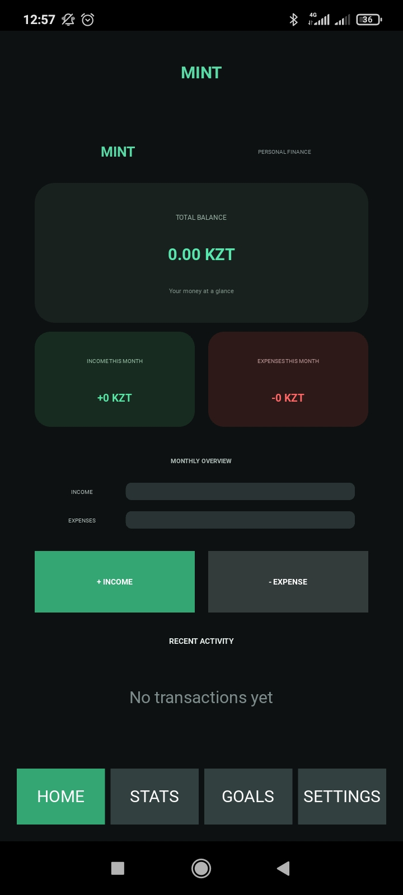
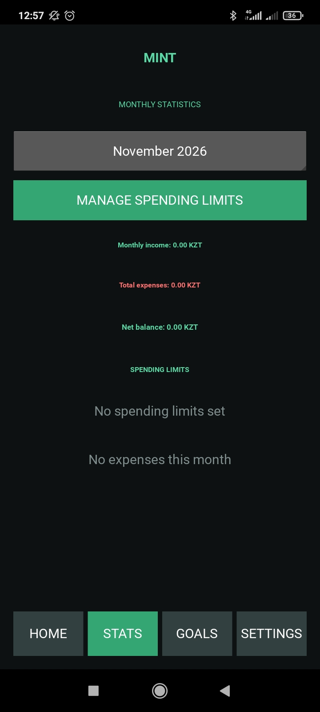
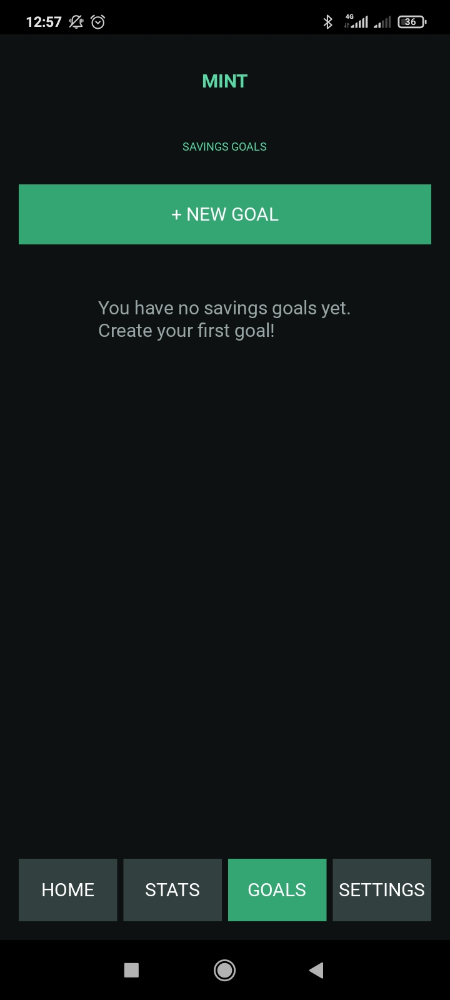
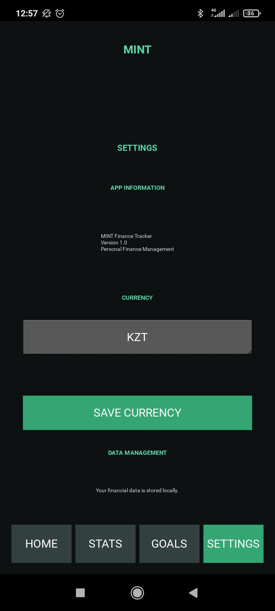

# 🌱 MINT — Personal Finance Tracker

A minimalist personal finance tracking application for Android, built with Python and Kivy.

MINT helps users manage income and expenses, track savings goals, and monitor their financial activity.

## 📱 Screenshots

### Home

### Statistics

### Savings Goals

### Settings

## ✨ Features

- Income and expense tracking
- Transaction history
- Expense categories
- Monthly financial statistics
- Spending charts
- Savings goals
- Balance tracking
- Local data storage

## 🛠 Technologies

- Python
- Kivy 2.3.1
- Buildozer
- GitHub Actions

## 📦 Android Application

MINT is packaged as a standalone Android APK.

## 👨‍💻 Project

Personal development project.
